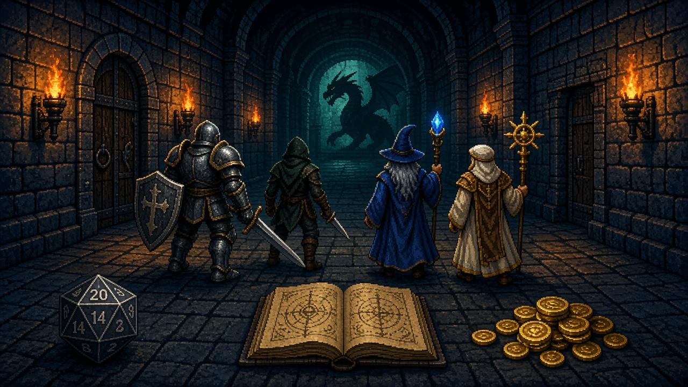

# Grok Adventures



A terminal dungeon crawl. You type or talk, Grok is the dungeon master, and Rust keeps the score.

Hit points, inventory, dice, companions, journal, rooms, and initiative live in game state. The model can change them only by calling tools. If it narrates a change without a tool, a marker fallback applies it once, and only when no mutating tool already ran that turn.

## Quick start

You need Rust 1.98+ (pinned in `rust-toolchain.toml`) and an xAI API key in `XAI_API_KEY` (or `[xai].api_key`). **Live play requires a key:** without one, the game exits before opening either UI. `cargo test`, `--help`, and `--demo` work without a key.

```bash
cp .env.example .env   # set XAI_API_KEY
cargo run
```

### See it without an API key

```bash
cargo run -- --demo
```

This prints a short, deterministic showcase of the player, DM, dice, tools, and state blocks plus the status line, then exits. It is a static illustration — no API calls, no key, no input, and no save. To actually play, run `cargo run` with `XAI_API_KEY` set.

A new game on a real terminal asks for a name and a class: fighter, rogue, wizard, cleric, or none. `--name` and `--class` each skip their own prompt. Saves land in `saves/` and stay out of git.

Saves are versioned JSON (`schema_version: 1` plus `state`), written atomically with the previous save kept as `.bak`. Saves from older builds — a raw `GameState` object — still load. Saves keep the last 8 exchanges and resume seeds DM chat history from them.

Defaults for interactive sessions: minimal UI, TTS and STT enabled, `grok-4.7` for the DM and autopilot player, and `low` reasoning effort. Fullscreen is opt-in with `--fullscreen` or `mode = "fullscreen"` in `config.toml`.

## CLI

| Flag | Effect |
|------|--------|
| `--name`, `-n` | Character name |
| `--class` | `fighter`, `rogue`, `wizard`, `cleric`, or `none` |
| `--load` | Save slot or path; skips the billed opening scene |
| `--minimal` | Linear transcript (the default) |
| `--fullscreen` | Status, scrollback, and prompt TUI |
| `--autopilot` | A second model plays; always minimal, no STT/TTS |
| `--turns` | Autopilot turn cap (default 20) |
| `--scripted-autopilot` | With `--autopilot`, fixed actions instead of the player model |
| `--player-style` | With `--autopilot`, style: `cautious`, `balanced`, or `reckless` |
| `--no-tts`, `--no-stt` | Silence speech or the mic for this session |
| `--config` | Config file path (default `config.toml`) |

## Slash and local commands

The bare-word aliases work without the slash. `save`, `load`, and `talk` take an argument only in slash form: `save the village`, `load the wagon`, and `talk to the innkeeper` are ordinary actions. Use `/save slot`, `/load slot`, and `/talk 8` for the commands. Only the commands marked **yes** call xAI.

| Command | Action | Calls xAI |
|---------|--------|-----------|
| `/help` | Command help | No |
| `/stats`, `/status` | Character sheet | No |
| `/inventory`, `/inv`, `/i` | Inventory from state | No |
| `/companions`, `/party` | Traveling companions | No |
| `/journal`, `/notes` | Remembered facts | No |
| `/rest` | Short rest (heals about 1/4 max HP; not in combat) | No |
| `/longrest`, `/long rest` | Long rest (HP to full; not in combat) | No |
| `/resurrect` | If dead, restore 1 HP for testing | No |
| `/save [slot\|path]` | Save (default slot: `autosave`); use the slash when passing a slot/path | No |
| `/load [slot\|path]` | Load a save, resetting chat/`/copy`/`/again` session context | No |
| `/again` | Repeat the last DM action (meta commands and local queries are not remembered) | **Yes** — DM turn |
| `/usage`, `/cost` | Session token usage: turns, API requests, prompt/completion/total tokens (not saved) | No |
| `/copy` | Copy the last DM narration (OSC 52, plus `cache/last-copy.txt`) | No |
| `/clear` | Clear the screen / fullscreen scrollback | No |
| `/talk [seconds]` | Record the mic, transcribe, then run the action | **Yes** — STT + DM turn |
| `/voice`, `/stt` | Toggle push-to-talk | No |
| `/tts` | Toggle DM speech | No |
| `/tools` | Expand/collapse tool blocks | No |
| `/theme` | Cycle `groknight` → `grokday` → `mono` (fullscreen only) | No |
| `/debug` | Dump complete game state | No |
| `/quit`, `/exit` | End the game | No |

Natural questions like "what's in my inventory?", "where am I?", and "how's my health?" are answered from state without a model call.

## What costs money

xAI bills the API calls directly; the app adds no markup. Local commands above are free. `/usage` (or `/cost`) shows the running session totals — turns, API requests, prompt tokens, completion tokens, and total tokens — without making a call. It covers the opening and every completed DM turn, including tool hops, resets when the app exits, and is not written to saves. Token rates are set by xAI, so the app reports tokens rather than estimating dollars.

| Action | Billed |
|--------|--------|
| Opening a new game | One DM turn; tool hops can add more chat requests |
| Each player action | One DM turn; tool hops can add more chat requests |
| `/again` | A DM turn |
| `/talk` | STT for the recorded audio, plus a DM turn |
| TTS narration | One `/v1/tts` request per sentence while TTS is on, including the opening |
| STT | Recorded audio duration, per minute, whether streaming or batch |
| `--autopilot` | A player-model call plus a DM turn per turn, plus the opening |
| `--autopilot --scripted-autopilot` | DM turns only (no player model), plus the opening |
`--load` skips the opening DM call: it shows the save's last narration under a `Previously…` line (falling back to the latest `DM:` log summary) and does not speak it. Model, token, and audio rates are set by xAI.

## Type, talk, and keys

Typing always works. Voice is optional. The primary voice target is macOS; playback uses `afplay` there and falls back to `ffplay`/`mpg123` elsewhere, and STT needs a working input device.

- **Minimal (default):** `talk` or `/talk [seconds]` records until Enter or its cap (the optional seconds value, otherwise `stt.max_record_seconds`, default 60). With `stt_edit_before_send = true` (default), the transcript lands in the prompt for editing.
- **Minimal cancel:** while waiting for the DM, Esc cancels the turn (restoring the pre-turn state) and Ctrl+C still quits; other keys typed during the wait are ignored.
- **Fullscreen:** hold Ctrl+Space or F2 while speaking, then release (press again to stop on terminals that do not report key releases). `/talk [seconds]` records until Enter or Esc; without an argument it uses `stt.record_seconds` (default 12). The transcript goes to the prompt by default, or is submitted immediately when edit-before-send is off.
- **Live transcription:** `stt.streaming = true` (default) shows words while you speak over the STT WebSocket. If that fails, the same clip is uploaded to the batch endpoint.
- **TTS defaults on.** Disable it with `/tts`, `--no-tts`, or `voice.enable_tts = false`. STT can be toggled with `/voice`, `--no-stt`, or `voice.enable_stt = false`.

Fullscreen keys:

- Enter sends. While the DM is working or speaking, the composer stays editable and Enter queues the line to run after the current turn (no second concurrent turn).
- Esc dismisses slash completions; from scrollback focus it returns to the prompt; otherwise it clears a non-empty draft. During a DM turn or speech it cancels the turn or stops speech instead. Esc never quits.
- Ctrl+C (or `/quit`) quits. Ctrl+D deletes at the cursor and does not quit.
- Tab completes a slash command when the menu is open. Otherwise it toggles focus only when the prompt is empty, so a draft is never stranded in scrollback. The shortcut bar shows `focus: scrollback`, and Esc returns to the prompt.
- Up/Down browse prompt history; while scrollback is focused they scroll the transcript. PageUp/PageDown and the mouse wheel always scroll the transcript.
- Readline editing: Ctrl+A home, Ctrl+E end, Ctrl+U delete to start, Ctrl+K delete to end, Ctrl+W delete word back, Ctrl+D delete at cursor, Ctrl+L clear scrollback.
- Multi-line paste is inserted as one editable line (line breaks and tabs become spaces); pasting never submits.

## A turn, illustrated

Illustrative only; names, tool results, and narration vary.

```text
You
  I search the altar for a hidden switch.

DM
  Your fingers find a seam in the cold stone. It clicks, and a small iron key tumbles into your palm.

State
  🎒 +Iron Key

Tools (2)
  · roll_dice → 14
  · add_to_inventory → Added Iron Key
```

The DM calls tools first and narrates from their results. State lines report only actual HP, room, or inventory changes. If the model describes a change without calling a mutating tool, the marker fallback can apply it once; a mutating tool disables that fallback for the turn.

## Data & privacy

The app talks only to `api.x.ai`; it has no analytics or third-party telemetry.

Sent to xAI:

- Your actions and prompts, plus game state, journal, recent history, and tool results used to build DM requests.
- Recorded mic audio and transcripts for STT when you use `talk`.
- DM narration text for TTS when speech is enabled.

Stays local:

- Slot saves under `saves/` (explicit save paths are used as given).
- The `/copy` fallback at `cache/last-copy.txt`.
- `config.toml` and `.env`.

Temporary WAV recordings and TTS MP3s are written under the OS temp directory and normally deleted after transcription/playback, or when playback is cancelled. The app makes no retention promises beyond that; xAI's terms govern what the API retains.

## Configuration

`config.toml` is the annotated sample. Environment variables override matching file values.

| Section | Working keys |
|---------|--------------|
| `[xai]` | `api_key` (prefer `XAI_API_KEY`), `model`, `player_model`, `reasoning_effort` |
| `[ui]` | `mode`, `theme`, `compact`, `tools_expanded`, `show_shortcuts` |
| `[voice]` | `enable_stt`, `stt_edit_before_send`, `enable_tts`, `dm_voice` |
| `[game]` | `tone`, `history_turns` |
| `[stt]` | `model`, `language`, `streaming`, `device`, `sample_rate`, `record_seconds`, `max_record_seconds` |

`theme` and `/theme` affect fullscreen; minimal uses the fixed GrokNight palette. `tone` understands `dark_fantasy`, `heroic`, and `comedic`; other values fall back to heroic. `record_seconds` is the fullscreen `/talk` default without an argument; minimal `/talk` and fullscreen hold-to-talk use `max_record_seconds` as the hard cap.

Unknown or removed config keys (for example the old `[game].ruleset`, `[voice].narrator_voice`, and `[tts].format`) are ignored, so older config files still load.

**Rules: dnd5e-lite.** Supported: d20 + ability modifier checks, standard dice (d4–d100), HP and death at 0, inventory, initiative order, and the homebrew short/long rests. Not supported: AC, proficiency, levels, spell slots, advantage/disadvantage state, death saves, or enemy stat blocks. The DM resolves those situations with the dice and tools that exist rather than implying missing mechanics.

Environment:

| Variable | Purpose |
|----------|---------|
| `XAI_API_KEY` | Required unless `[xai].api_key` is set; environment or `.env` preferred |
| `XAI_MODEL` | DM chat model (default `grok-4.7`) |
| `XAI_PLAYER_MODEL` | Autopilot player model (default `grok-4.7`) |
| `XAI_REASONING_EFFORT` | `low`, `medium`, `high`, or `xhigh` (default `low`) |
| `XAI_STT_MODEL` | STT model (default `grok-voice-transcribe-2.0`) |
| `GROK_ADVENTURES_PLAYER_STYLE` | `cautious`, `balanced`, or `reckless` (default `balanced`) |
| `GROK_ADVENTURES_SCRIPTED_AUTOPILOT` | `1`, `true`, or `yes` forces scripted autopilot |
| `GROK_ADVENTURES_DEBUG` | `1`, `true`, or `yes` expands tool blocks |
| `NO_COLOR` | Non-empty value disables ANSI colors |
| `RUST_LOG` | Tracing filter (default `warn`) |

## Develop

```bash
cargo test
cargo clippy --all-targets -- -D warnings
```

`cargo test` does not call the network. The live API smokes are ignored:

```bash
cargo test --test live_api -- --ignored --nocapture
cargo test --test live_tts -- --ignored --nocapture
```

GitHub Actions runs formatting, clippy, and tests on pushes to `main` and on pull requests. Pushing a `v*` tag builds Linux x86_64 and macOS aarch64 release binaries and attaches them to a GitHub release.

See [docs/plan.md](docs/plan.md) for archived design notes and current architecture.

## License

MIT
